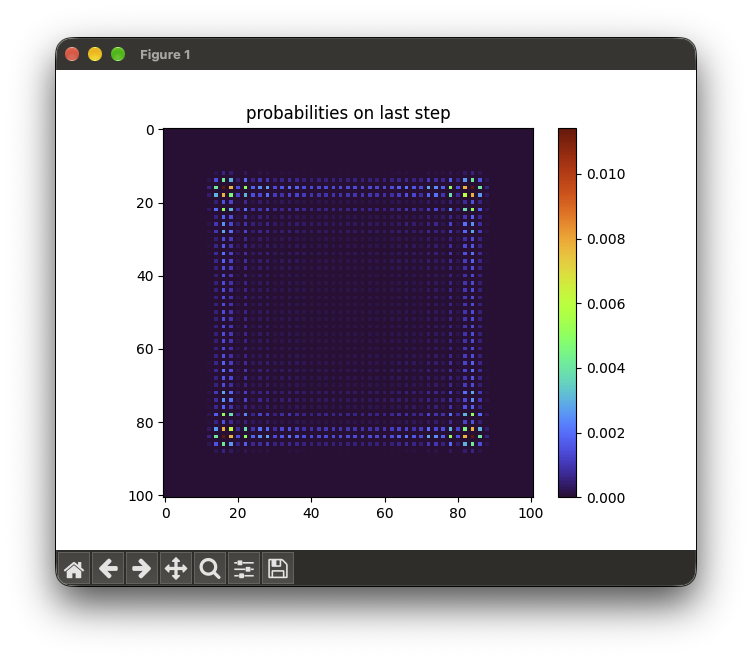

# quantumcrawl
Python libraty meant to simplify simulations of 2d quantum walks on discrete grid and search of a most symmetric distibution of given parameters.

## Installation (using pip)

### main branch

```bash
pip install git+https://github.com/filipkojro/quantumcrawl.git
```
Versions of libraries in dependencies was copied from my current workstation. Other versions may or may not work.

### testing branch

If you want most up to date version but **not yet tested** you can install from testing branch.
```bash
pip install git+https://github.com/filipkojro/quantumcrawl.git@testing
```

## Example usage

### Optimization
```python
import quantumcrawl.walk
import quantumcrawl.coin_operators

walkFnormal = quantumcrawl.walk.Walk(coin4all=quantumcrawl.coin_operators.coinH, diag=True)
walkFnormal.optimize()
walkFnormal.preety_print_optimize_results()
```

#### Results

```
(venv) [main] ~/repos/quantumcrawl $ python test.py 
===============================================================================================================

scipy response mess CONVERGENCE: RELATIVE REDUCTION OF F <= FACTR*EPSMCH

last try metric: 0.02724136965249191

starting table [-0.59275177  0.82361449  0.50913029 -0.0174116   0.50913027 -0.01741175
  0.64763444  0.78119469]

translator:
[a0, a1, a2, a3, a4, a5,a 6, a7]
[a0 + a1j, a2 + a3j, a4 + a5j, a6 + a7j]

starting state [-0.36914385+0.5129166j   0.31706749-0.0108433j   0.31706748-0.01084339j
  0.40332275+0.48649913j]

von neumann entropy: 0.9999999999999998

===============================================================================================================
```



### Only simulation
```python
import quantumcrawl.coin_operators
import quantumcrawl.walk
import matplotlib.pyplot as plt

walk = quantumcrawl.walk.Walk(coin4all=quantumcrawl.coin_operators.coinF, starting_state=[ 0, 0, 0, 0, 0, 0, 1, 0], num_steps=100)
walk.walk()

plt.imshow(walk.history[-1], cmap='turbo', )
plt.title("probabilities on last step")
plt.autoscale()
plt.colorbar()
plt.show()
```

#### Results


